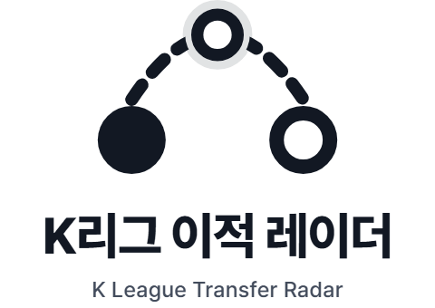
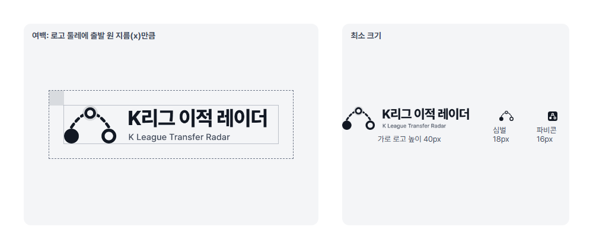
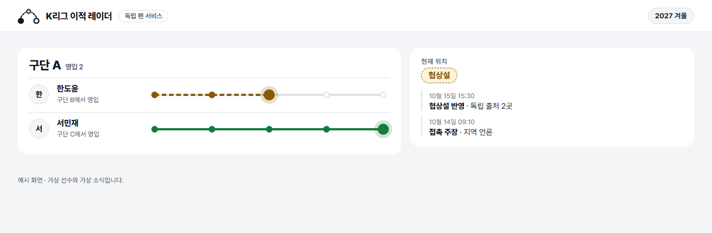
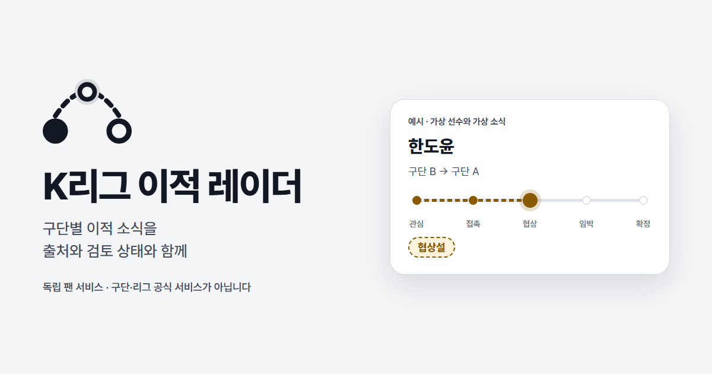

# 브랜드 가이드: 이적 경로

K리그 이적 레이더의 브랜드 가이드입니다. 2026-10-15에 [방향 시안](README.md) 세 가지 중 **2 이적 경로**를 골랐습니다. 이 문서와 `kit/`만으로 다른 담당자가 같은 표현을 다시 만들 수 있도록 썼습니다.


## 1. 핵심 아이디어

출발 구단(채운 원)과 도착 구단(빈 원)을 점선 호가 잇고, 호의 꼭대기에 지금 반영된 위치가 있습니다.

- **이적 자체를 그렸습니다.** 레이더 원형이 아니라 "어디서 어디로, 지금 어디쯤"이라는 서비스의 질문을 그대로 그렸습니다.
- **열린 모양은 주장, 채운 모양은 반영·확인입니다.** 화면에서 루머를 점선과 빈 원으로 그리는 규칙([디자인 인계](../docs/design/README.md))과 같습니다. 그래서 도착 원은 비어 있고, 경로는 점선입니다.
- **잉크 한 색입니다.** K리그1·2 구단 색이 거의 모든 색상을 쓰고 있어서, 어떤 색을 골라도 특정 구단이 떠오릅니다. 화면의 단계 색과도 겹치지 않아야 합니다. 그래서 브랜드에는 강조색이 없고, 색은 데이터의 상태에만 씁니다.

## 2. 로고 체계

| 구성 | 파일 | 쓰는 곳 |
| --- | --- | --- |
| 가로 로고 | `kit/svg/ktr-logo-h-<variant>.svg` | 기본. 소개 페이지, 문서 머리, 공유 이미지 |
| 세로 로고 | `kit/svg/ktr-logo-v-<variant>.svg` | 정사각형에 가까운 자리, 스플래시, 발표 표지 |
| 심벌 | `kit/svg/ktr-symbol-<variant>.svg` | 서비스 헤더(글자는 HTML로), 프로필 이미지 |
| 앱 아이콘 | `kit/svg/ktr-app-icon-light.svg`, `-dark.svg` | 홈 화면, PWA, 스토어 |
| 파비콘 | `kit/favicon/ktr-favicon.svg`, `favicon.ico` | 브라우저 탭 (32 격자로 다시 그린 축약형) |

| 변형 (`<variant>`) | 색 | 쓰는 곳 |
| --- | --- | --- |
| `light` | 잉크 `#121823`, 영문 `#434c5c`, 후광 잉크 12% | 밝은 바탕 |
| `dark` | `#e9edf3`, 영문 `#c0c7d2`, 후광 16% | 어두운 바탕 |
| `mono-black` | `#000000` 한 색, 후광 없음 | 흑백 인쇄, 한 색만 쓸 수 있는 자리 |
| `mono-white` | `#ffffff` 한 색, 후광 없음 | 사진·짙은 색 위 반전 |



**만든 방식:** 호는 현재 위치 점 둘레(반지름 80, 1024 격자 기준)에서 끊겨 있습니다. 현재 위치 점은 속이 빈 고리라서 어떤 바탕에서도 칠할 색이 필요 없습니다. 기하 값은 [tokens.json](tokens.json)의 `symbolGeometry`에 있습니다.

### 여백과 최소 크기



- **여백:** 로고 둘레에 출발 원 지름(x)만큼 비웁니다. x = 심벌 높이 × 0.39.
- **최소 크기:** 가로 로고 높이 40px(영문 줄이 읽히는 한계), 심벌만 쓸 때 높이 18px. 그보다 작으면 파비콘 축약형을 씁니다.
- **서비스 헤더:** 심벌 28px + HTML 글자 "K리그 이적 레이더" 17px 800. 폭이 좁으면(360px 미만) "이적 레이더"로 줄입니다.

### 하지 말 것

- 단계 색(파랑·호박·보라·초록·빨강)이나 구단 색으로 로고를 칠하지 않습니다. 특히 **초록은 공식 확정 표시 전용**입니다.
- 도착 원을 채우거나 점선 호를 실선으로 바꾸지 않습니다. "확정된 이적"으로 읽힙니다.
- 화살표나 체크 표시를 더하지 않습니다.
- 늘이거나 기울이거나, 그림자·그라데이션을 넣지 않습니다.
- 구단·리그 엠블럼 옆에 나란히 놓아 제휴처럼 보이게 하지 않습니다.

## 3. 색

| 역할 | 라이트 | 다크 | 대비 |
| --- | --- | --- | --- |
| 브랜드 잉크 (심벌, 워드마크, 본문) | `#121823` | `#e9edf3` | 바탕 위 16.3:1 / 16.3:1 |
| 보조 잉크 (영문 줄, 설명) | `#434c5c` | `#c0c7d2` | 7.9:1 / 11.3:1 |
| 바탕 (앱 아이콘, 페이지, 공유 이미지) | `#f4f5f7` | `#0c0f14` | — |
| 표면 (카드, 헤더) | `#ffffff` | `#151a22` | 잉크 17.8:1 / 14.9:1 |
| 선 (흰 바탕 위 타일 테두리, 구분선) | `#dfe2e8` | `#252c38` | 장식용 |

- 대비는 WCAG 2 계산값입니다. 화면의 `--muted #6a7384`는 흰 표면 위에서 4.77:1이지만 `#f4f5f7` 바탕 위에서는 4.38:1이라, **바탕 위 작은 글자에는 보조 잉크를 씁니다.**
- **상태색은 브랜드 색이 아닙니다.** 단계·검토 색은 [docs/design/tokens.css](../docs/design/tokens.css)를 따르고 데이터에만 씁니다.
- 토큰 파일: [tokens.css](tokens.css), [tokens.json](tokens.json)

## 4. 글꼴

| 역할 | 글꼴·굵기 | 크기·행간 |
| --- | --- | --- |
| 워드마크 | Pretendard 800, 자간 -0.03em | 로고 기준 |
| 영문 줄 | Pretendard 500, 자간 +0.015em | 워드마크의 0.43배 |
| 화면 제목(구단명) | Pretendard 800 | 22px / 1.3 |
| 선수명 | Pretendard 800 | 15px |
| 본문 | Pretendard 400 | 14px / 1.55 |
| 메타·날짜 | Pretendard 400~600 | 12px |
| 숫자(건수, 시각) | Pretendard, `font-variant-numeric: tabular-nums` | 본문과 같음 |

- **라이선스:** Pretendard는 SIL OFL 1.1로 상업적 사용과 웹 임베딩이 가능합니다. 글꼴 파일만 따로 판매할 수는 없습니다. 원본은 `assets/PretendardVariable.woff2`(v1.3.9)이고 라이선스 전문은 `assets/Pretendard-LICENSE.txt`에 있습니다.
- **대체 글꼴:** `"Pretendard Variable", Pretendard, -apple-system, "Apple SD Gothic Neo", "Malgun Gothic", system-ui, sans-serif`
- 한글·영문 선수명이 섞인 목록에서 같은 글꼴 하나로 굵기만 바꿔 위계를 만듭니다. 영문 전용 글꼴을 따로 두지 않습니다.

## 5. 이름과 문장

| 구분 | 표기 |
| --- | --- |
| 한국어 표시명 | **K리그 이적 레이더** (권장, 현재 그대로) |
| 축약명 | 이적 레이더 (좁은 헤더, 앱 아이콘 아래 이름) |
| 영문 | K League Transfer Radar (로고 영문 줄은 하이픈 없이) |
| 저장소·코드 | `k-league-transfer-radar`, 파일 접두어 `ktr-` |
| 성격 표기 | 독립 팬 서비스 |

- 이름 변경은 하지 않았습니다. 요청서대로 별도 선택 사항입니다.
- **짧은 소개:** "구단별 이적 소식을 출처와 검토 상태와 함께 봅니다."
- **긴 소개:** "K리그 이적 레이더는 커뮤니티와 언론의 이적 주장을 구단·선수별로 모으고, 변화 이력과 원문을 함께 보여 주는 독립 팬 서비스입니다. 구단이나 리그의 공식 서비스가 아닙니다."
- **말투:** 명료하고 친숙한 존댓말. 판단은 출처에 맡기고, 서비스는 "누가 무엇을 말했는지"를 전합니다.
- **금지 표현:** 단독, 확실, 100%, 오피셜(공식 확인 전), AI 예측 적중, 선수 평가·조롱. 공식 발표가 없는 소식은 "관심설·협상설"처럼 "~설"로 씁니다. 화면 문구 전체는 [문구표](../docs/design/copy.md)를 따릅니다.

## 6. 적용 예시

| 장면 | 파일 |
| --- | --- |
| 서비스 헤더 + 목록·상세 일부 (라이트, 1280) | `kit/examples/app-light-1280.png` |
| 같은 화면 (다크, 1280) | `kit/examples/app-dark-1280.png` |
| 모바일 헤더 + 목록 (390) | `kit/examples/app-light-390.png`, `app-dark-390.png` |
| 소셜 공유 이미지 1200×630 | `kit/social/ktr-og-1200x630.png` |
| 파비콘 16·32·48, apple-touch-icon 180 | `kit/favicon/` |





- 브랜드는 헤더와 공유 이미지에만 나옵니다. 목록과 상세에서는 단계 색이 일하고, 브랜드 잉크는 글자에만 씁니다.
- 공유 이미지와 예시의 선수·구단·소식은 모두 가상입니다. "예시 · 가상 선수와 가상 소식" 표시를 지우지 않습니다.
- **엠블럼과 선수 사진은 쓰지 않습니다.** 사용 조건이 확인되지 않았으므로, 구단은 이름 글자로, 선수는 이름 첫 글자 아바타로 대신합니다.

## 7. 파일과 이름 규칙

```text
branding/
  guide.md                    # 이 문서
  tokens.css / tokens.json    # 브랜드 토큰
  brand.json                  # 시안 목록과 선택 (selected: route)
  assets/PretendardVariable.woff2
  concepts/<id>/              # 방향 시안 원본 3종 (아이콘·로고·스플래시)
  scripts/build-kit.mjs       # kit/ 전체를 만드는 스크립트
  kit/                        # 생성물 (직접 고치지 말고 스크립트를 고친다)
    svg/      ktr-symbol-*, ktr-logo-h-*, ktr-logo-v-*, ktr-app-icon-*
    png/      위 SVG의 PNG (@2x, 512, 1024·512·192)
    favicon/  ktr-favicon.svg, favicon.ico, favicon-16/32/48.png, apple-touch-icon.png
    social/   og.html(원본), ktr-og-1200x630.png
    examples/ app-<theme>-<width>.html/.png, clear-space.html/.png
```

**이름 규칙:** `ktr-<자산>-<변형>[-<크기>|@2x].<확장자>`. 자산은 `symbol`, `logo-h`, `logo-v`, `app-icon`, `favicon`, `og`, 변형은 `light`, `dark`, `mono-black`, `mono-white`입니다.

**다시 만들기** (저장소 루트, 헤드리스 Chrome 또는 Playwright Chromium과 ffmpeg 필요):

```powershell
node branding/scripts/build-kit.mjs
```

웹 적용 예:

```html
<link rel="icon" href="/favicon.ico" sizes="32x32">
<link rel="icon" href="/ktr-favicon.svg" type="image/svg+xml">
<link rel="apple-touch-icon" href="/apple-touch-icon.png">
<meta property="og:image" content="/ktr-og-1200x630.png">
```

## 8. 남은 일

- **로고 글자 윤곽선 변환:** SVG의 워드마크는 지금 글자(`<text>`)라 Pretendard가 없으면 다른 글꼴로 보입니다. 외부에 넘기는 SVG는 윤곽선으로 바꿔야 합니다. PNG는 Pretendard로 렌더링돼 있습니다.
- **스토어 규격:** iOS(마스크 없는 1024 등)와 Android 적응형 아이콘(전경·배경 분리)은 앱을 만들 때 내보냅니다. 심벌은 이미 가운데 66% 안전 영역 안에 있습니다.
- **확인하지 못한 것:** 실제 브라우저 탭, 메신저 공유 미리보기, 휴대폰 홈 화면에서의 모습.
