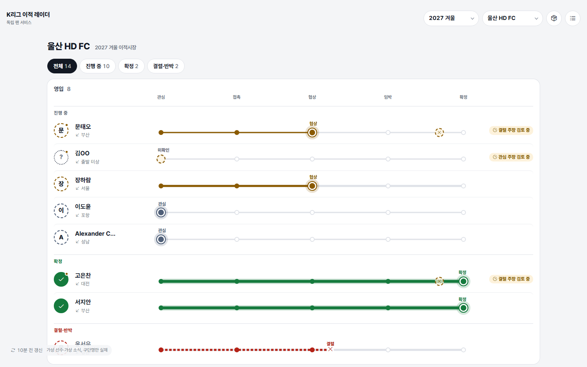
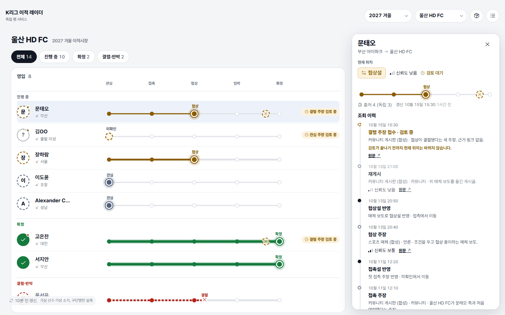
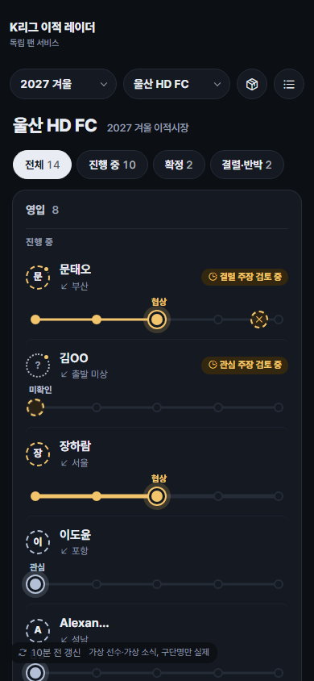
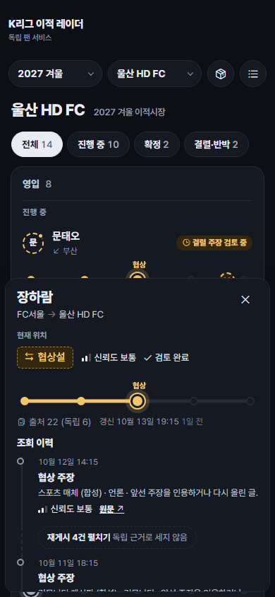

# 디자인 인계 자료

공개 조회 화면의 채택 디자인은 **배송 조회형**입니다. 이적 건 하나를 택배 조회처럼 관심 → 접촉 → 협상 → 임박 → 확정 다섯 역을 지나는 막대로 보여 주고, 상세는 "조회 이력"으로 보여 줍니다.

| 문서 | 내용 |
| --- | --- |
| [작업지시서](work-order.md) | 만들 것, 지킬 규칙, 데이터 연결, 작업 순서와 완료 기준, 점검표, 결정이 필요한 것. **여기서 시작하세요** |
| [컴포넌트 명세](components.md) | 화면 구조, 조회 막대·행·아바타·필터·상세·이력·상태 화면의 크기와 규칙, 접근성 |
| [문구표](copy.md) | 화면의 모든 문구와 오류 메시지 |
| [tokens.css](tokens.css) / [tokens.json](tokens.json) | 색(라이트·다크), 글꼴, 간격, 모서리, 막대 치수, 모션 |
| [assets/](assets/) | 기준 화면 스크린샷 12장(목록·상세·상태, 라이트·다크, 데스크톱·모바일) |

| 미리보기 | |
| --- | --- |
|  |  |
|  |  |

## 디자인이 정해진 과정

- 1차 목록형 3종([transfer-radar](../ux-concepts/transfer-radar/)): 보류.
- 2차 연결 그래픽([transfer-map](../ux-concepts/transfer-map/)): 마인드맵·리그 네트워크·레이더 궤도.
- 3차 선 없는 그래픽([transfer-board](../ux-concepts/transfer-board/)): 전광판·배송 조회·칸반·계기판·버블·모자이크·카드 덱.
- 2026-10-15 사용자가 배송 조회를 선호안으로 고르고 "상세도 배송 조회처럼 + 목록 강화"를 승인.

## 데이터에 대해

화면 예시의 구단명은 실제 K리그 구단이지만, 선수·이적 주장·출처·날짜는 모두 가상입니다. K리그1·2 배치도 예시이며 실제 시즌 승강과 무관합니다. 실제 데이터로 오인되지 않도록 스크린샷을 외부에 공개할 때는 이 점을 함께 적어 주세요.
